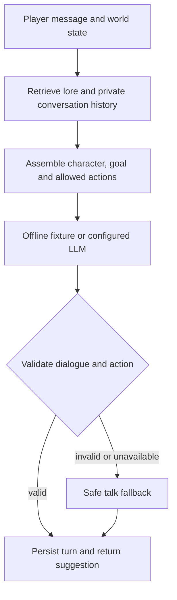

# LLM-Powered Game NPCs

A small, inspectable Python framework for persistent game characters. Mira, a village archivist, retrieves relevant world lore, recalls earlier conversations with the same player, and proposes an action permitted by the current world state.

**Status:** runnable reference implementation, not a production game backend. The offline demo is deterministic; connect an LLM for generative dialogue. No model training or benchmark performance is claimed.

## Quick start

Requires Python 3.10 or newer. No runtime dependencies or API key are needed for the offline demo.

```sh
python -m pip install -e .
npc-demo --message "Where is the old bridge?"
npc-demo --message "What did we discuss about the bridge?"
python -m unittest discover -s tests -v
```

The default SQLite file persists conversations across runs. Use `--db :memory:` for an ephemeral session and `--player another-player` for separate history.

Example offline response:

```json
{
  "dialogue": "Mira: The old bridge lies north of the village; its eastern arch is damaged.",
  "action": "talk",
  "sources": ["bridge"],
  "fallback": false
}
```

The offline fixture demonstrates plumbing; it does not reason over memory or vary its personality.

## How a turn works



| Component | Implementation |
|---|---|
| Personality and goal | Immutable character configuration injected into each prompt |
| Persistent memory | SQLite, partitioned by character and player |
| Retrieval | Transparent token-overlap ranking; up to 3 lore entries and 4 memories |
| Contextual decisions | Host-defined allowed actions: talk, flee during danger, trade at an open shop |
| Generation | Configurable chat-completions HTTP adapter returning JSON |
| Validation | Dialogue bounds, action allowlist, transport/format fallback |
| Integration | Python API returning a structured suggestion; host executes actions |

## Connect a language model

Configure a trusted endpoint that supports chat-completions messages. Choose a model available on your provider. The model must return a JSON object containing `dialogue` and `action`; malformed responses fall back to talk.

PowerShell:

```powershell
$env:NPC_ENDPOINT = "http://localhost:11434/v1/chat/completions"
$env:NPC_MODEL = "your-installed-model"
# For a hosted service, use its HTTPS endpoint and set NPC_API_KEY.
npc-demo --live --message "Can you help me find the bridge?"
```

Hosted requests send the character, retrieved memories, lore, player message and world state to the configured provider. Keep credentials in environment variables. Live provider compatibility must be tested against your chosen service.

## Use in a game

```python
from npc_engine import Character, Memory, NPC, OfflineProvider, World

memory = Memory("save.sqlite3")
try:
    npc = NPC(
        Character("mira", "Mira", "Patient and precise", "Protect village history"),
        memory,
        OfflineProvider(),
        [{"id": "bridge", "text": "The bridge is north of the village."}],
    )
    reply = npc.turn("player-42", "Where is the bridge?", World(danger=True))
    print(reply.dialogue, reply.action, reply.sources)
finally:
    memory.close()
```

The host must recheck world state before executing an action. NPC output never directly changes the game world. Give each concurrent worker its own SQLite connection.

## Documentation

- [Architecture and contracts](docs/architecture.md)
- [Evaluation and research directions](docs/evaluation.md)
- [Integration and operational limits](docs/integration.md)
- [Contributing](CONTRIBUTING.md)

## Limitations

Lexical retrieval can miss paraphrases. Memory searches the latest 200 entries per player/character and stores dialogue verbatim. Source IDs identify retrieved context, not verified sentence-level citations. Prompt instructions do not guarantee immunity to prompt injection or factual accuracy. The package has no authentication, multiplayer server, embeddings, autonomous planning, engine plugin, or production moderation layer.

MIT licensed; see [LICENSE](LICENSE).
